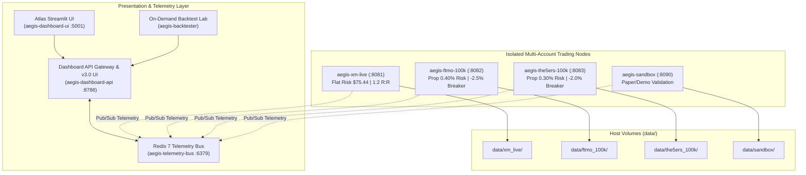

# Aegis Alpha — Multi-Account Docker Containerization Engine

Production-grade, fully isolated containerization architecture for autonomous quantitative trading on **MetaTrader 5 (MT5)**. Designed for running multiple accounts simultaneously (Live Native Brokers, FTMO, The5ers Prop Firms) with zero port collisions, separate risk models, dedicated databases, decoupled Redis telemetry message bus, unified API & Streamlit presentation layers, and live web-based GUI streaming via **noVNC**.

---

## 1. Architectural Overview



### Core Architecture Highlights
* **Full Process & Memory Isolation**: Each trading account runs in its own Linux container with a dedicated Wine 64-bit instance, MT5 desktop terminal, Python runtime, and SQLite database.
* **Decoupled Telemetry Message Bus**: High-velocity non-blocking telemetry emitter pushes live candle scans, open positions, peak excursions, and trade executions to Redis 7 (`telemetry-bus`).
* **Zero Socket Port Collisions**: Every container runs the internal MT5 socket bridge on `127.0.0.1:8888`.
* **Remote Browser GUI (noVNC)**: Access and monitor any live MT5 chart window directly in your web browser via noVNC without installing local desktop software.
* **Prop Firm Compliance & Rules Engines**: Tailored risk allocations (FTMO 0.40% risk with -2.5% daily drawdown breaker, The5ers 0.30% risk with -2.0% daily breaker) preventing rule breaches.
* **Profile-Aware Backtesting Lab**: Dedicated container profile for running on-demand multi-month simulations with institutional certification grading (Sharpe, Deflated Sharpe, max DD, prop pass/fail).

---

## 2. Port & Service Directory

| Service | Container Name | Host Port | Internal Port | Description |
| :--- | :--- | :---: | :---: | :--- |
| **`telemetry-bus`** | `aegis-telemetry-bus` | **`6379`** | `6379` | Redis 7 in-memory pub/sub telemetry cache |
| **`dashboard-api`** | `aegis-dashboard-api` | **`8788`** | `8787` | FastAPI backend & Aegis Alpha v3.0 Web UI |
| **`dashboard-ui`** | `aegis-dashboard-ui` | **`5001`** | `5000` | Atlas Streamlit multi-asset frontend UI |
| **`trader-sandbox`** | `aegis-sandbox` | **`8090`** | `8080` (noVNC) | Isolated test/demo node ($75 flat risk) |
| **`trader-xm-live`** | `aegis-xm-live` | **`8081`** | `8080` (noVNC) | XM Live broker node ($75.44 flat risk, 1:2 R:R) |
| **`trader-ftmo-100k`** | `aegis-ftmo-100k` | **`8082`** | `8080` (noVNC) | FTMO $100k prop firm node (0.40% risk, -2.5% breaker) |
| **`trader-the5ers-100k`**| `aegis-the5ers-100k`| **`8083`** | `8080` (noVNC) | The5ers $100k prop firm node (0.30% risk, -2.0% breaker) |
| **`backtester`** | `aegis-backtester` | *CLI* | *CLI* | On-demand profile-aware historical backtest simulator |

---

## 3. Quick Start Guide

### 3.1 Launch the Telemetry Bus & Dashboard UI
To spin up the Redis telemetry bus, API gateway, and Streamlit frontend:
```bash
docker compose up -d telemetry-bus dashboard-api dashboard-ui
```

Access the interfaces:
* **Aegis Alpha v3.0 Web UI**: `http://localhost:8788/`
* **Atlas Streamlit UI**: `http://localhost:5001/`
* **API Health Check**: `http://localhost:8788/api/health`

### 3.2 Launch a Trading Account (Sandbox Example)
1. Initialize volume directories:
   ```bash
   mkdir -p data/sandbox/terminal data/sandbox/trading_data
   ```
2. Copy your portable MT5 terminal files (`terminal64.exe` and subfolders) into `data/sandbox/terminal/`.
3. Configure credentials:
   ```bash
   cp configs/sandbox_demo.env.example configs/sandbox_demo.env
   nano configs/sandbox_demo.env
   ```
4. Start the container:
   ```bash
   docker compose up -d trader-sandbox
   ```
5. View MT5 chart window in browser:
   * Direct or via SSH tunnel (`ssh -L 8090:localhost:8090 user@remote-ip`):
   * 👉 **`http://localhost:8090/vnc.html`** (Click **Connect**)

---

## 4. Prop Firm Node Setup

### FTMO $100,000 Node (`trader-ftmo-100k`)
1. Create environment config:
   ```bash
   cp configs/ftmo_100k.env.example configs/ftmo_100k.env
   ```
2. Populate credentials in `configs/ftmo_100k.env`:
   - `FTMO_LOGIN`, `FTMO_PASSWORD`, `FTMO_SERVER`
3. Copy FTMO MT5 terminal files into `data/ftmo_100k/terminal/`.
4. Launch container:
   ```bash
   docker compose up -d trader-ftmo-100k
   ```
5. View live terminal: Forward port `8082` and browse `http://localhost:8082/vnc.html`.

### The5ers $100,000 Node (`trader-the5ers-100k`)
1. Create environment config:
   ```bash
   cp configs/the5ers_100k.env.example configs/the5ers_100k.env
   ```
2. Configure credentials in `configs/the5ers_100k.env`.
3. Copy The5ers MT5 files into `data/the5ers_100k/terminal/`.
4. Launch container:
   ```bash
   docker compose up -d trader-the5ers-100k
   ```
5. View live terminal: Forward port `8083` and browse `http://localhost:8083/vnc.html`.

---

## 5. Profile-Aware Backtesting Lab

Run isolated, reproducible historical simulations across broker profiles and prop firm evaluation rules:

```bash
# 1. Run backtest for FTMO $100k profile over 1 year
docker compose run --rm backtester --profile ftmo_100k --period 1y

# 2. Run backtest for The5ers $100k profile over 6 months
docker compose run --rm backtester --profile the5ers_100k --period 6mo

# 3. Run backtest for XM Live profile over 2 years
docker compose run --rm backtester --profile xm_live --period 2y
```

### Available Account Profiles
* `xm_live`: Spot Gold XM Live baseline ($1,000 seed, $75.44 flat risk, 1.25R target)
* `ftmo_100k`: $100k initial balance, 0.40% risk ($400), 5% max daily DD, 10% target
* `the5ers_100k`: $100k initial balance, 0.30% risk ($300), 3% max daily DD, 6% target
* `blueguardian_50k`: $50k initial balance, 0.40% risk ($200), 4% max daily DD
* `sandbox_demo`: $1,000 sandbox test profile

Generated reports are automatically saved to `reports/backtests/` in both `.md` and `.json` formats.

---

## 6. Daily Operations & CLI Commands

```bash
# Check status of all containers
docker compose ps

# Follow logs of a specific service
docker compose logs -f telemetry-bus
docker compose logs -f dashboard-api
docker compose logs -f trader-xm-live

# Query in-memory telemetry state from Redis
docker exec -it aegis-telemetry-bus redis-cli hgetall "aegis:scans:model_1"

# Run full automated test suite
pytest tests/test_account_backtest.py tests/test_telemetry.py -v

# Stop a container cleanly
docker compose stop trader-xm-live

# Tear down all services
docker compose down
```

---

## 7. Security Best Practices

* **Zero Credential Leakage**: All actual `.env` files in `configs/` and persistent volume data in `data/` are strictly excluded in `.gitignore`. Never commit `.env` files with live account passwords.
* **Network Isolation**: All inter-service telemetry communication runs exclusively within the private Docker bridge network (`aegis-net`).
* **Source Separation**: Main production execution on the host server runs independently in `gold-trading-system`, keeping production execution completely uncoupled from Docker development environments.
